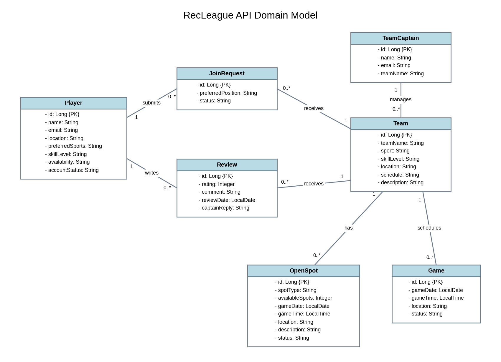

# RecLeague backend API

# UML Class Diagram



# API Overview

**Version:** 1.0
**Last Updated:** October 23, 2026
**Framework:** Spring Boot 4.1.1 / Java 25

**Base URL:**

- local: http://localhost:8080/api
- production: https://recleague-api.onrender.com/api

RecLeague lets players find and join recreational sports teams, while team
captains manage teams, open spots, rosters, and reviews.

API requests and responses use JSON, and request bodies are validated. The
endpoint tables list applicable error codes: `400 Bad Request` for invalid
input and `404 Not Found` for missing resources. Listed codes are typical
responses, not an exhaustive guarantee for every failure.

## Profile and team management

| Method   | Path                                     | Purpose                               | Response code    | Error codes |
| -------- | ---------------------------------------- | ------------------------------------- | ---------------- | ----------- |
| `GET`    | `/api/players`                           | List players                          | `200 OK`         | —           |
| `POST`   | `/api/players`                           | Register a player profile             | `201 Created`    | `400`       |
| `GET`    | `/api/players/{id}`                      | View a player profile                 | `200 OK`         | `404`       |
| `PUT`    | `/api/players/{id}`                      | Update a player profile               | `200 OK`         | `400, 404`  |
| `POST`   | `/api/team-captains`                     | Register a team captain profile       | `201 Created`    | `400`       |
| `GET`    | `/api/team-captains/{id}`                | View a team captain profile           | `200 OK`         | `404`       |
| `PUT`    | `/api/team-captains/{id}`                | Update a team captain profile         | `200 OK`         | `400, 404`  |
| `POST`   | `/api/team-captains/{id}/teams`          | Create a team                         | `201 Created`    | `400, 404`  |
| `GET`    | `/api/team-captains/{id}/teams`          | View the captain's teams              | `200 OK`         | `404`       |
| `PUT`    | `/api/team-captains/{id}/teams/{teamId}` | Update a team                         | `200 OK`         | `400, 404`  |
| `DELETE` | `/api/team-captains/{id}/teams/{teamId}` | Delete a team and its associated data | `204 No Content` | `404`       |

### Example Team Captain Request


POST /api/team-captains
Content-Type: application/json

{
  "name": "Test Captain",
  "email": "captain.recleague.test@example.com",
  "password": "example-test-password-123",
  "teamName": "Saiyans"
}
```

Example response (`201 Created`):

```json
{
  "id": 1,
  "name": "Test Captain",
  "email": "captain.recleague.test@example.com",
  "teamName": "Saiyans"
}
```

### Example Player Request


POST /api/players
Content-Type: application/json

{
  "name": "Daniel Brown",
  "email": "daniel.brown.reviews@example.com",
  "location": "Greensboro, NC",
  "preferredSports": "Basketball",
  "skillLevel": "Intermediate",
  "availability": "Weekends"
}
```

### Example Team Request


POST /api/team-captains/1/teams
Content-Type: application/json

{
  "teamName": "Saiyans",
  "sport": "Basketball",
  "skillLevel": "Advanced",
  "location": "Greensboro, NC",
  "schedule": "Sunday at 4 PM",
  "description": "Competitive basketball team looking for experienced players."
}
```

## Open spots and roster

| Method  | Path                                                                       | Purpose                    | Response code | Error codes |
| ------- | -------------------------------------------------------------------------- | -------------------------- | ------------- | ----------- |
| `POST`  | `/api/team-captains/{id}/teams/{teamId}/spots`                             | Post an open spot          | `201 Created` | `400, 404`  |
| `GET`   | `/api/team-captains/{id}/teams/{teamId}/spots`                             | View open spots            | `200 OK`      | `404`       |
| `PUT`   | `/api/team-captains/{id}/teams/{teamId}/spots/{spotId}`                    | Update an open spot        | `200 OK`      | `400, 404`  |
| `PATCH` | `/api/team-captains/{id}/teams/{teamId}/spots/{spotId}/close`              | Close an open spot         | `200 OK`      | `404`       |
| `POST`  | `/api/players/{playerId}/teams/{teamId}/join-requests`                     | Request to join a team     | `201 Created` | `400, 404`  |
| `GET`    | `/api/players/{playerId}/join-requests`                                   | View my join requests (approved ones are my teams) | `200 OK`         | `404`       |
| `DELETE` | `/api/players/{playerId}/join-requests/{requestId}`                       | Cancel a pending join request                      | `204 No Content` | `404, 409`  |
| `GET`   | `/api/team-captains/{id}/teams/{teamId}/join-requests`                     | View pending join requests | `200 OK`      | `404`       |
| `GET`   | `/api/team-captains/{id}/teams/{teamId}/roster`                            | View the approved roster   | `200 OK`      | `404`       |
| `PATCH` | `/api/team-captains/{id}/teams/{teamId}/join-requests/{requestId}/approve` | Approve a join request     | `200 OK`      | `400, 404`  |
| `PATCH` | `/api/team-captains/{id}/teams/{teamId}/join-requests/{requestId}/decline` | Decline a join request     | `200 OK`      | `400, 404`  |

`gameDate` uses `YYYY-MM-DD`; `gameTime` uses a local 24-hour time such as
`16:00:00`.

Join requests start as `PENDING`. Approval changes the status to `APPROVED`,
which also represents roster membership; the captain can instead mark the
request `DECLINED`.
A player can cancel their own request only while it is still `PENDING`;
cancelling an approved or declined request returns `409 Conflict`.

### Example Open Spot Request


POST /api/team-captains/1/teams/1/spots
Content-Type: application/json

{
  "spotType": "Point Guard",
  "availableSpots": 2,
  "gameDate": "2026-11-01",
  "gameTime": "16:00:00",
  "location": "Greensboro, NC",
  "description": "Looking for experienced players."
}
```

### Example Join Request


POST /api/players/1/teams/1/join-requests
Content-Type: application/json

{
  "preferredPosition": "Point Guard"
}
```

## Reviews

| Method  | Path                                                              | Purpose               | Response code | Error codes |
| ------- | ----------------------------------------------------------------- | --------------------- | ------------- | ----------- |
| `POST`  | `/api/players/{playerId}/teams/{teamId}/reviews`                  | Submit a team review  | `201 Created` | `400, 404`  |
| `GET`   | `/api/teams/{teamId}/reviews`                                     | View a team's reviews | `200 OK`      | `404`       |
| `PATCH` | `/api/team-captains/{id}/teams/{teamId}/reviews/{reviewId}/reply` | Reply to a review     | `200 OK`      | `400, 404`  |
| `GET`    | `/api/players/{playerId}/reviews`                                | View reviews I've written                    | `200 OK`         | `404`       |
| `PUT`    | `/api/players/{playerId}/reviews/{reviewId}`                     | Edit my review (the captain's reply is kept) | `200 OK`         | `400, 404`  |
| `DELETE` | `/api/players/{playerId}/reviews/{reviewId}`                     | Delete my review                             | `204 No Content` | `404`       |

Only an active player with an approved join request for that team can submit a
review in the current implementation. Ratings are from 1 to 5.
Players can only view, edit, or delete their own reviews.

### Example Review Request


POST /api/players/1/teams/1/reviews
Content-Type: application/json

{
  "rating": 5,
  "comment": "Great basketball team! Everyone is friendly and organized."
}
```

### Example Captain Reply Request


PATCH /api/team-captains/1/teams/1/reviews/1/reply
Content-Type: application/json

{
  "captainReply": "Thank you for your review! We're glad you enjoyed playing with us."
}
```

Example response (`200 OK`):

```json
{
  "id": 1,
  "playerId": 1,
  "playerName": "Daniel Brown",
  "teamId": 1,
  "rating": 5,
  "comment": "Great basketball team! Everyone is friendly and organized.",
  "reviewDate": "2026-10-21",
  "captainReply": "Thank you for your review! We're glad you enjoyed playing with us."
}
```

### Example Review Update Request

```http
PUT /api/players/1/reviews/1
Content-Type: application/json

{
  "rating": 4,
  "comment": "Great team, but games sometimes start late."
}
```

## SysAdmin

The SysAdmin endpoints allow administrators to manage user access, moderate teams and reviews, and view basic platform usage statistics.

| Method | Path | Purpose | Response code | Error codes |
| --- | --- | --- | --- | --- |
| `GET` | `/api/sysadmin/players` | View all player accounts | `200 OK` | — |
| `GET` | `/api/sysadmin/captains` | View all team captain accounts | `200 OK` | — |
| `PUT` | `/api/sysadmin/players/{id}/status?status={status}` | Activate or suspend a player account | `200 OK` | `400, 404` |
| `PUT` | `/api/sysadmin/captains/{id}/status?status={status}` | Activate or suspend a team captain account | `200 OK` | `400, 404` |
| `DELETE` | `/api/sysadmin/players/{id}` | Remove a player account and associated data | `204 No Content` | `404` |
| `DELETE` | `/api/sysadmin/captains/{id}` | Remove a team captain account and associated teams | `204 No Content` | `404` |
| `GET` | `/api/sysadmin/teams` | View all team listings | `200 OK` | — |
| `DELETE` | `/api/sysadmin/teams/{id}` | Remove a team and its associated data | `204 No Content` | `404` |
| `GET` | `/api/sysadmin/reviews` | View all reviews | `200 OK` | — |
| `DELETE` | `/api/sysadmin/reviews/{id}` | Remove a review | `204 No Content` | `404` |
| `GET` | `/api/sysadmin/statistics` | View platform usage statistics | `200 OK` | — |

Account status can be set to `ACTIVE` or `SUSPENDED`. Any other value returns `400 Bad Request`.

When a player is removed, associated reviews and join requests are also removed. When a team or team captain is removed, associated team data is safely cleaned up before deletion.

### Example SysAdmin Status Update

```http
PUT /api/sysadmin/players/1/status?status=SUSPENDED
```

Example response (`200 OK`):

```json
{
  "id": 1,
  "name": "Test Player",
  "email": "testplayer@example.com",
  "location": "Greensboro",
  "preferredSports": "Soccer",
  "skillLevel": "Beginner",
  "availability": "Weekends",
  "accountStatus": "SUSPENDED"
}
```

### Example Usage Statistics

```http
GET /api/sysadmin/statistics
```

Example response (`200 OK`):

```json
{
  "players": 1,
  "teamCaptains": 0,
  "totalUsers": 1,
  "teams": 0,
  "reviews": 0
}
```

## Status code reference

| Code              | Meaning                    |
| ----------------- | -------------------------- |
| `200 OK`          | Success with response body |
| `201 Created`     | New resource created       |
| `204 No Content`  | Successful deletion        |
| `400 Bad Request` | Invalid input              |
| `404 Not Found`   | Missing resource           |

# Testing and Deployment

The API runs in Docker on Render, backed by PostgreSQL on Neon.

**Live API:** https://recleague-api.onrender.com